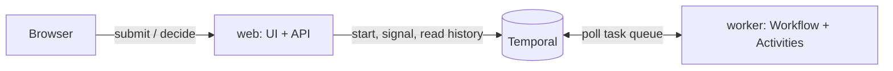

# Expense Approval

An expense approval app whose approvals wait as long as they need to, even when every worker is gone.

- A **Workflow** checks policy, notifies an approver, waits for a decision, escalates, pays, and notifies the employee.
- The approver's decision arrives as a **[Signal](https://docs.temporal.io/develop/go/message-passing#signals)**, which Temporal records even while no worker is running.
- Escalation and expiry are **[durable timers](https://docs.temporal.io/develop/go/timers)** (`workflow.AwaitWithTimeout`), visible as live countdowns.
- A flaky payment provider is handled by a **[Retry Policy](https://docs.temporal.io/encyclopedia/retry-policies)**, not a retry loop.
- Every screen is built from the Workflow's **Event History**, so the app keeps working while workers are down.

It follows Temporal's [Approval pattern](https://docs.temporal.io/design-patterns/approval).

## How it works



| Component | What it does |
|---|---|
| `web` (`cmd/web`) | Serves the app, starts `ExpenseApproval`, sends the decision Signal, and reads history. Runs no Workflow code, so it stays up when workers disappear. |
| `worker` (`cmd/worker`) | Runs the Workflow (`expense/workflow.go`) and its Activities (`expense/activities.go`). |

The Workflow, top to bottom:

1. **Check expense policy.** $50 and under is auto-approved; over $5,000 is refused.
2. **Notify the approver** (Sam Chen), then wait up to `ESCALATE_AFTER` for a decision.
3. **Escalate** to Dana Ortiz if there is none, then wait until `EXPIRE_AFTER` before expiring.
4. **Pay the reimbursement**, retrying with backoff. The Workflow ID is the payment idempotency key.
5. **Notify the employee.**

The first valid decision wins. Duplicates, late replies, and replies from someone who can't decide yet are ignored by the Workflow itself.

## Demo script

**30-second version:** "This is an expense approval. It waits for a manager, escalates if they're slow, and pays out through a flaky payment provider. I'm going to kill the worker in the middle, and nothing will be lost."

| Beat | Do | Point out |
|---|---|---|
| 1. Happy path | Click **Team lunch** → **Submit** | Auto-approved by policy and paid in a few seconds. Each step in the journey comes from Event History. |
| 2. Durable wait | Click **Conference** → **Submit** | It's now waiting for Sam Chen. The countdown is a durable timer, and the code panel highlights `AwaitWithTimeout`. |
| 3. Crash | Stop the worker (`Ctrl-C` on `make worker`, or the catalog's crash control) | The app keeps working. |
| 4. Decide anyway | **Approve** in the Approver inbox | "Decision recorded", then "No worker is running this step". The Signal is safe in Temporal. |
| 5. Recover | Start the worker again | The Workflow picks up the decision, pays, and finishes. **Open execution ↗** shows the Signal in the Event History. |
| 6. Escalation | Submit an expense and don't decide | After `ESCALATE_AFTER` it escalates to Dana Ortiz, who can now approve it. |
| 7. Retries | Click **Client dinner · payment outage** → Submit → Approve | Payment fails three times, and Temporal retries with backoff until it succeeds. |
| 8. Policy | Click **Laptop · $7,200** | Refused by policy without a person in the loop. |

**New session** gives the presenter a clean slate. Each browser has its own private set of requests.

## Run it locally

Prerequisites: Go 1.26+ and the [Temporal CLI](https://docs.temporal.io/cli).

```sh
make temporal   # terminal 1: Temporal dev server, UI at http://localhost:8233
make worker     # terminal 2: stop and restart this one during the demo
make web        # terminal 3: the app at http://localhost:8080
```

`make test` runs the Workflow tests. `make image` builds the container image, which holds both `/app/web` (default) and `/app/worker`.

### Configuration

| Variable | Default | Used by |
|---|---|---|
| `TEMPORAL_ADDRESS`, `TEMPORAL_NAMESPACE`, `TEMPORAL_API_KEY`, `TEMPORAL_TLS*` | `localhost:7233`, `default` | both |
| `TEMPORAL_TASK_QUEUE` | `expense-approval` | both |
| `ESCALATE_AFTER` / `EXPIRE_AFTER` | `45s` / `10m` | web, passed into each Workflow |
| `TEMPORAL_UI_URL` | Temporal Cloud, or `http://localhost:8233`, for the namespace | web |
| `PORT` | `8080` | web |

The Temporal CLI's config file is ignored on purpose, so a developer's default profile can't point the demo at a real namespace.

## Run it on tmprl-demo.cloud

`deploy/expense-approval.yaml` is the `DemoProject` resource for the [demo catalog](https://github.com/temporal-sa/tmprl-demo-cloud-registry). The platform provides the Temporal Cloud namespace and API key, builds the image, and supports crashable workspaces: a per-user copy with its own task queue whose worker can be crashed or scaled to zero from the catalog.
